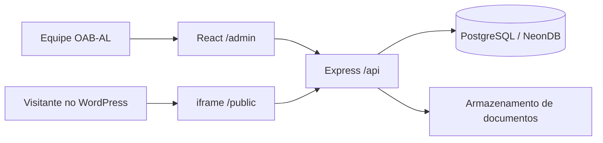

# Arquitetura

## Decisão

O produto será uma plataforma única, hospedada em `transparencia.orbiapp.com.br`, com dois contextos de interface no mesmo frontend React:

- `/admin`: portal autenticado de gestão;
- `/public`: portal público incorporável no WordPress.

As duas áreas reutilizam o mesmo design system, os mesmos componentes de domínio, contratos Zod e formatadores. A separação por rotas e layouts impede que controles administrativos vazem para a área pública.



## URLs previstas

| Finalidade        | URL                                                  |
| ----------------- | ---------------------------------------------------- |
| Login             | `https://transparencia.orbiapp.com.br/login`         |
| Administração     | `https://transparencia.orbiapp.com.br/admin`         |
| Portal público    | `https://transparencia.orbiapp.com.br/public`        |
| Categoria pública | `https://transparencia.orbiapp.com.br/public/:secao` |
| API               | `https://transparencia.orbiapp.com.br/api`           |

`/public` redireciona para `/public/institucional` ou apresenta essa categoria como rota index.

## Estrutura prevista do monorepo

```text
portal_transparencia_oab/
├── apps/
│   ├── web/                  # React: login, admin e public
│   └── api/                  # Express: autenticação, gestão e leitura pública
├── packages/
│   ├── ui/                   # componentes visuais compartilhados
│   ├── contracts/            # schemas Zod e tipos compartilhados
│   └── config-typescript/
├── docs/
├── package.json
├── pnpm-workspace.yaml
└── turbo.json
```

## Fronteiras internas do frontend

```text
apps/web/src/
├── app/                      # composition root e router com divisão por rota
├── components/
│   ├── ui/                   # primitivas visuais
│   └── shared/               # componentes com usos equivalentes comprovados
├── modules/
│   ├── public-shell/         # hero, navegação e layout público
│   ├── auth/                 # sessão, usuários e shell administrativo
│   ├── foundation/           # diagnóstico de disponibilidade da API
│   ├── general-data/         # API, queries e componentes de Dados Gerais
│   ├── budget/               # API, queries e páginas do Orçamentário
│   ├── financial/            # API, queries, páginas e accordion financeiro
│   ├── human-resources/      # API, queries e páginas de Recursos Humanos
│   ├── patrimonial/          # API, queries e páginas de Patrimônio
│   ├── contracts/            # contratos e fornecedores
│   ├── reports/              # indicadores e gráficos carregados sob demanda
│   ├── institutional/        # conteúdo institucional estático tipado
│   ├── administrative/       # organograma e embed institucional
│   ├── glossary/             # glossário estático tipado
│   └── lgpd/                 # política e acordeões estáticos tipados
└── lib/                      # transporte HTTP e utilitários sem regra de domínio
```

O compartilhamento ocorre em componentes e módulos de domínio, não pela mistura dos layouts. A área pública nunca importa componentes de autenticação ou edição.

Os módulos alimentados pela API validam respostas na borda, encapsulam queries e
mutations do TanStack Query e mantêm suas query keys no próprio domínio. Mutations
atualizam o cache administrativo e invalidam somente as consultas públicas
afetadas. Conteúdos institucionais sem CRUD permanecem como fontes estáticas
tipadas dentro de seus próprios módulos.
Estados de página, cabeçalhos, filtros, links de download e contêineres de tabela
são compartilhados somente quando preservam a mesma semântica entre páginas; regras
de negócio e formatos de cada domínio permanecem no respectivo módulo. As páginas
são carregadas por rota; o Chart.js permanece fora do bundle inicial e só é
importado pelo módulo de Relatórios.

## Fronteiras internas da API

```text
apps/api/src/
├── app.ts                    # composition root
├── errors/                   # tradução centralizada de erros para HTTP
├── infrastructure/           # Prisma compartilhado e tratamento de erros do banco
├── middlewares/              # CORS e guards de autenticação/autorização
├── test/                     # utilitários compartilhados somente entre testes
└── modules/                  # fatias verticais por domínio
│   ├── auth/
│   ├── budget/
│   ├── contracts/
│   ├── financial/
│   ├── general-data/
│   ├── health/
│   ├── human-resources/
│   ├── patrimonial/
│   └── reports-indicators/
```

O `app.ts` configura os middlewares globais, cria os services como singletons lazy,
injeta as dependências nos módulos de rota e registra o error handler por último.
Controllers usam os schemas Zod compartilhados nas entradas já cobertas e não
acessam o Prisma diretamente. CORS usa uma whitelist explícita e é aplicado antes de
todos os routers.

IDs, exercícios e filtros de query são validados por schemas Zod compartilhados na
borda HTTP. A inicialização também valida e tipa as variáveis de ambiente. Erros de
validação, rota inexistente, CORS e JSON malformado usam respostas JSON consistentes.

A autorização segue uma matriz explícita: administradores possuem acesso total,
editores alteram conteúdo e revisores publicam. Rate limits usam contadores
persistidos no PostgreSQL; excesso autenticado revoga todas as sessões do usuário e
aplica bloqueio temporário. Logs estruturados recebem request ID e não incluem
tokens, cookies, bodies ou query strings. Mutations autenticadas concluídas também
registram ação, recurso, status e identificador do usuário, sem dados pessoais ou
credenciais. Sessões expiradas ou revogadas são removidas antes da emissão de um
novo token. O frontend propaga logout entre abas e revalida a sessão na API ao
retornar do histórico.

Listagens administrativas potencialmente abertas usam paginação por `page` e
`limit`, com teto de 100 itens. As consultas usam ordenação estável, `count` e
índices compostos alinhados aos filtros e à ordenação. Usuários são selecionados
sem `passwordHash`, e a validação de sessão busca somente os campos públicos do
usuário. Contratos mantêm `supplierId` obrigatório com chave estrangeira para
impedir fornecedores órfãos ou exclusões inconsistentes.

Cada módulo concentra router, controller, service, interface de repository,
adapter Prisma e testes do domínio. Services dependem das interfaces locais de
repository; controllers não acessam o Prisma. A infraestrutura de banco permanece
compartilhada e é injetada nos adapters pelo composition root.

### Regra de componentização

- Elementos visuais básicos e independentes de domínio pertencem a `packages/ui`.
- Componentes usados somente por um módulo ficam próximos dele em `apps/web/src/modules`.
- Uma página compõe componentes; ela não deve repetir marcação de cards, tabelas, filtros ou documentos.
- A extração ocorre quando há repetição real ou um conceito de domínio claro. Não criamos abstrações genéricas antes de conhecer suas variações.
- Administrativo e público podem compartilhar apresentação e contratos, mas controles de edição permanecem exclusivos do layout administrativo.

## Estratégia de dados

1. Domínios com gestão administrativa acessam a API por clientes HTTP próprios.
2. O portal administrativo grava rascunhos no banco e publica versões.
3. A área pública lê apenas a versão publicada de cada exercício.
4. Services do backend dependem de interfaces de repository; Prisma fica restrito
   aos adapters e à infraestrutura compartilhada.
5. Institucional, Administrativo, Glossário e LGPD permanecem como conteúdo
   estático tipado, sem CRUD ou API artificial.

## Publicação e embed

O WordPress incorporará `https://transparencia.orbiapp.com.br/public` por shortcode/bloco de iframe.

- O layout público não replica cabeçalho e rodapé globais do WordPress.
- A altura será sincronizada com `postMessage` para evitar scroll duplo.
- Pai e filho validarão rigorosamente a origem das mensagens.
- A resposta do app usará `Content-Security-Policy: frame-ancestors` autorizando apenas os domínios oficiais da OAB-AL.
- O servidor não poderá enviar `X-Frame-Options` incompatível com a incorporação entre domínios.
- Downloads e links externos abrirão fora do iframe quando necessário.

## Banco e arquivos

- PostgreSQL serverless no NeonDB, acessado com Prisma.
- Documentos PDF/CSV/XLSX ficam em armazenamento de objetos; o banco guarda metadados, versão, exercício, categoria e URL/chave do arquivo.
- Alterações passam por rascunho, revisão, publicação e histórico.
- Exclusões publicadas devem ser preferencialmente lógicas, preservando auditoria.
