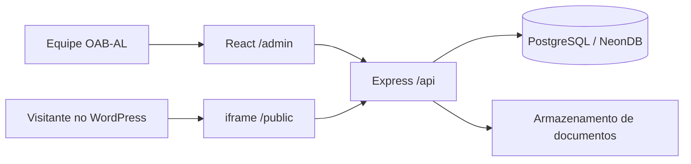

# Arquitetura

## Decisão

O produto será uma plataforma única, hospedada em `transparencia.orbiapp.com.br`, com dois contextos de interface no mesmo frontend React:

- `/admin`: portal autenticado de gestão;
- `/public`: portal público incorporável no WordPress.

As duas áreas reutilizam o mesmo design system, os mesmos componentes de domínio, contratos Zod e formatadores. A separação por rotas e layouts impede que controles administrativos vazem para a área pública.



## URLs previstas

| Finalidade        | URL                                                  |
| ----------------- | ---------------------------------------------------- |
| Login             | `https://transparencia.orbiapp.com.br/login`         |
| Administração     | `https://transparencia.orbiapp.com.br/admin`         |
| Portal público    | `https://transparencia.orbiapp.com.br/public`        |
| Categoria pública | `https://transparencia.orbiapp.com.br/public/:secao` |
| API               | `https://transparencia.orbiapp.com.br/api`           |

`/public` redireciona para `/public/institucional` ou apresenta essa categoria como rota index.

## Estrutura prevista do monorepo

```text
portal_transparencia_oab/
├── apps/
│   ├── web/                  # React: login, admin e public
│   └── api/                  # Express: autenticação, gestão e leitura pública
├── packages/
│   ├── ui/                   # componentes visuais compartilhados
│   ├── contracts/            # schemas Zod e tipos compartilhados
│   └── config-typescript/
├── docs/
├── package.json
├── pnpm-workspace.yaml
└── turbo.json
```

## Fronteiras internas do frontend

```text
apps/web/src/
├── app/
│   ├── admin/                # rotas e layout autenticados
│   └── public/               # rotas e layout incorporáveis
├── features/                 # módulos por domínio
├── components/               # componentes compartilhados da aplicação
├── data/                     # cliente HTTP e repositório local temporário
└── styles/                   # tokens e estilos globais
```

O compartilhamento ocorre em componentes e módulos de domínio, não pela mistura dos layouts. A área pública nunca importa componentes de autenticação ou edição.

## Fronteiras internas da API

```text
apps/api/src/
├── app.ts                    # composition root
├── errors/                   # tradução centralizada de erros para HTTP
├── infrastructure/           # Prisma compartilhado e tratamento de erros do banco
├── middlewares/              # CORS e guards de autenticação/autorização
├── test/                     # utilitários compartilhados somente entre testes
└── features/                 # fatias verticais por domínio
│   ├── auth/
│   ├── budget/
│   ├── contracts/
│   ├── financial/
│   ├── general-data/
│   ├── health/
│   ├── human-resources/
│   ├── patrimonial/
│   └── reports-indicators/
```

O `app.ts` configura os middlewares globais, cria os services como singletons lazy,
injeta as dependências nos módulos de rota e registra o error handler por último.
Controllers usam os schemas Zod compartilhados nas entradas já cobertas e não
acessam o Prisma diretamente. CORS usa uma whitelist explícita e é aplicado antes de
todos os routers.

IDs, exercícios e filtros de query são validados por schemas Zod compartilhados na
borda HTTP. A inicialização também valida e tipa as variáveis de ambiente. Erros de
validação, rota inexistente, CORS e JSON malformado usam respostas JSON consistentes.

A autorização segue uma matriz explícita: administradores possuem acesso total,
editores alteram conteúdo e revisores publicam. Rate limits usam contadores
persistidos no PostgreSQL; excesso autenticado revoga todas as sessões do usuário e
aplica bloqueio temporário. Logs estruturados recebem request ID e não incluem
tokens, cookies, bodies ou query strings. Sessões expiradas ou revogadas são
removidas antes da emissão de um novo token. O frontend propaga logout entre abas e
revalida a sessão na API ao retornar do histórico.

Cada feature concentra router, controller, service, interface de repository,
adapter Prisma e testes do domínio. Services dependem das interfaces locais de
repository; controllers não acessam o Prisma. A infraestrutura de banco permanece
compartilhada e é injetada nos adapters pelo composition root.

### Regra de componentização

- Elementos visuais básicos e independentes de domínio pertencem a `packages/ui`.
- Componentes usados somente pelo portal ficam próximos da feature em `apps/web/src/features`.
- Uma página compõe componentes; ela não deve repetir marcação de cards, tabelas, filtros ou documentos.
- A extração ocorre quando há repetição real ou um conceito de domínio claro. Não criamos abstrações genéricas antes de conhecer suas variações.
- Administrativo e público podem compartilhar apresentação e contratos, mas controles de edição permanecem exclusivos do layout administrativo.

## Estratégia de dados por ciclo

1. O frontend público começa com fixtures tipadas que reproduzem o conteúdo atual.
2. Os componentes consomem uma interface de repositório, não os JSONs diretamente.
3. A API implementa a mesma interface por HTTP.
4. O portal administrativo grava rascunhos no banco e publica versões.
5. A área pública lê apenas a versão publicada de cada exercício.

## Publicação e embed

O WordPress incorporará `https://transparencia.orbiapp.com.br/public` por shortcode/bloco de iframe.

- O layout público não replica cabeçalho e rodapé globais do WordPress.
- A altura será sincronizada com `postMessage` para evitar scroll duplo.
- Pai e filho validarão rigorosamente a origem das mensagens.
- A resposta do app usará `Content-Security-Policy: frame-ancestors` autorizando apenas os domínios oficiais da OAB-AL.
- O servidor não poderá enviar `X-Frame-Options` incompatível com a incorporação entre domínios.
- Downloads e links externos abrirão fora do iframe quando necessário.

## Banco e arquivos

- PostgreSQL serverless no NeonDB, acessado com Prisma.
- Documentos PDF/CSV/XLSX ficam em armazenamento de objetos; o banco guarda metadados, versão, exercício, categoria e URL/chave do arquivo.
- Alterações passam por rascunho, revisão, publicação e histórico.
- Exclusões publicadas devem ser preferencialmente lógicas, preservando auditoria.
